# Symbolic regression on MARSIS radar data
### Explainable AI project work: explicit physical laws for the quality of the MARSIS echo

---

## Contents

1. [How to reproduce](#1-how-to-reproduce)
2. [Introduction](#2-introduction)
3. [Dataset](#3-dataset)
4. [Method](#4-method)
5. [Results](#5-results)
   1. [One formula for everything?](#51-one-formula-for-everything)
   2. [The night law at 4 MHz](#52-the-night-law-at-4-mhz)
   3. [Anomalous orbits](#53-anomalous-orbits)
   4. [All frequencies at night: the antenna resonance](#54-all-frequencies-at-night-the-antenna-resonance)
   5. [Daytime ionospheric attenuation](#55-daytime-ionospheric-attenuation)
   6. [A single model for the whole dataset](#56-a-single-model-for-the-whole-dataset)
6. [Conclusions](#6-conclusions)

---

## 1. How to reproduce

Requirements: Python 3.11 with the packages in `requirements.txt` (PySR installs Julia at the first run).
The path of the dataset CSV is set in `src/config.py` (`CSV_PATH`).

```bash
python src/prepare_data.py                                                   # CSV → data/marsis.parquet
python src/run_experiments.py --exp all_data         --step explore search residuals
python src/run_experiments.py --exp all_data_long    --step search
python src/run_experiments.py --exp night_4mhz       --step explore search validate residuals anomalies
python src/run_experiments.py --exp night_4mhz_clean --step validate
python src/run_experiments.py --exp night_allfreq    --step explore search validate
python src/run_experiments.py --exp attenuation      --step attenuation search validate exponents
python src/run_experiments.py --exp combined         --step validate residuals
python src/run_experiments.py --exp combined_all     --step validate
python src/make_figures.py                                                   # all figures in plots/
```

The order matters: the anomalous orbits found by `night_4mhz` are excluded by the later experiments, and the
`attenuation` step computes the target of the other `attenuation` steps. Experiments are defined in
`src/config.py`, formulas in `formulas.toml`, results in `results/<experiment>/`.


---

## 2. Introduction

MARSIS (Mars Advanced Radar for Subsurface and Ionosphere Sounding), on board Mars Express, is a
low-frequency radar sounder (1.8–5 MHz). It sends a pulse towards the surface and records the echo.
The power of the surface echo is a measure of the quality of the observation: a weak echo means
that the subsurface cannot be studied.

**Goal.** Find a mathematical function that explains the echo power from the observing conditions.
If one function is not enough, split the dataset in a logical way and find a function for each part.

**Tool.** Symbolic regression with PySR (Cranmer, 2023). Instead of training a black box, PySR searches
the space of **explicit formulas** (sums, products, logarithms, …) and returns, for each level of
complexity, the formula that best fits the data.

**Reference paper.** Ferrari et al. (ECAI 2025), *Explainable Artificial Intelligence for Quality
Estimation of MARSIS Observations*, study the same dataset with a neural network explained with SHAP
and with an Explainable Boosting Machine (EBM), at 4 MHz only. The paper is used here as context and
as a term of comparison, **not** as something to replicate: the aim is to obtain information that
those methods cannot give directly, such as physical coefficients, exponents and the dependence on
frequency. The comparison with the paper is made where it is relevant, along the results.

**Target.** `peak_corrected_echo_power`, the peak power of the surface echo, in dB.

---

## 3. Dataset

| Property | Value |
|---|---|
| Rows | 4,230,657 (one measurement every ~2 s along the orbit) |
| Columns | 25, all numerical |
| Period | December 2005 – January 2021 |
| Orbits | 727 |
| Region | **south polar cap only**, latitude −87° to −68° |
| Frequencies | 1.8 MHz (28,706 rows), 3 MHz (873,412), 4 MHz (2,083,317), 5 MHz (1,245,222) |

MARSIS transmits on two bands at the same time, so the same instant usually appears in two rows,
one per frequency (2,328,163 distinct instants).

The observations are not uniform in time (Figure 1). They come in **campaigns** separated by years
without data, and each campaign has its own conditions: some are almost entirely by day (2007, 2009,
2020), others by night (2012–2016); high solar activity (F10.7) is concentrated in 2012–2014.
This structure drives several choices of the project, from the validation scheme to the split of
the data.

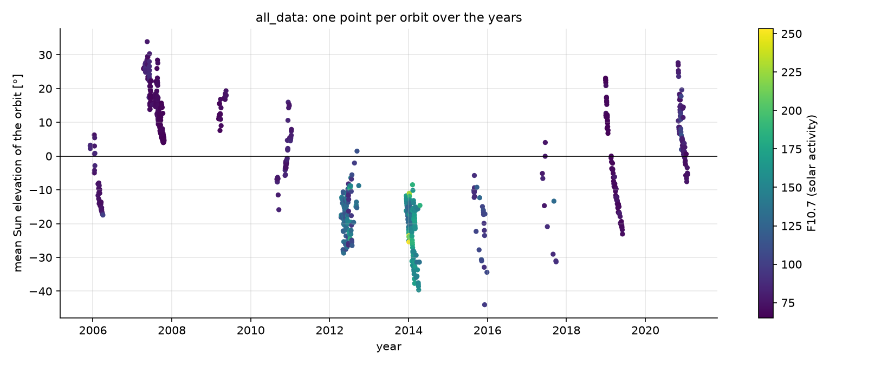
*Figure 1 – One point per orbit: mean Sun elevation (negative = night) and solar activity F10.7
(colour) over the years, whole dataset.*

### 3.1 Physical features

The target is in dB, so multiplicative physical effects become sums. The expected structure is

$$
P\,[\mathrm{dB}] \approx \text{const} + \text{reflectivity} - \text{geometric loss} - \text{roughness loss} - \text{ionospheric absorption}.
$$

The raw columns are transformed into **physical features**, so that the formulas PySR has to find
are shorter and their variables have a physical meaning:

| Feature | Definition | Motivation |
|---|---|---|
| `log10_altitude_km` | $\log_{10} h$ | specular reflection: $P \propto 1/h^2$, i.e. $-20\log_{10} h$ in dB |
| `roughness_over_lambda` | $\sigma/\lambda$ | a surface scatters according to its roughness relative to the wavelength (Rayleigh criterion) |
| `cos_sza` | $\cos\chi = \sin(\text{Sun elevation})$ | ionisation depends on the solar zenith angle $\chi$ (Chapman); negative at night |
| `f107_at_mars` | $F = F_{10.7}/d^2$ ($d$ in AU) | F10.7 is measured at 1 AU; the flux reaching Mars scales with $1/d^2$ |
| `dipole_dev` | $\lvert\text{dipole tilt} - 90°\rvert$ | how far the antenna is from its optimal orientation |
| `freq_mhz` | $f$ | only 4 distinct values |
| `sin_ls`, `cos_ls`, `slope` | season, surface slope | candidate variables |

Combining F10.7 and the Mars–Sun distance into a single variable addresses a problem pointed out by the
paper, where the two columns appear confounded in the explanations.

**Excluded inputs.** Columns derived from the same measurement as the target (noise floor, distorted
and simulated echo power, SNR) would be *leakage*. Orbit number and time would let a model learn
*when* instead of *why*. Latitude, longitude and the projected coordinates would act as a place
identifier. The noise floor is used only later, as an independent check (section 5.3).

**Drawback.** The form of some laws (for example the logarithm of the altitude) is suggested by us
through the features: the data decide the coefficient, not the form.

---

## 4. Method

### 4.1 Symbolic regression with PySR

PySR evolves a population of formulas built from the allowed operators, optimises their constants
and keeps, for each complexity, the best formula: the **Pareto front** of error versus complexity.
Settings used:

| Setting | Value |
|---|---|
| Binary operators | $+\ -\ \times\ \div$ (and `^` for the attenuation) |
| Unary operators | $\log_{10}$, $\sqrt{\ }$, square, $\exp$ |
| Nested constraints | no $\log(\log)$, $\exp(\exp)$, $\log(\exp)$, …; the exponent of `^` is a constant or a variable |
| Loss | absolute error (L1), consistent with the MAE |
| Maximum size | 25 (20 for the attenuation) |
| Data | a sample of 10,000–12,000 training rows, balanced by frequency when there are several |
| Iterations, seeds | 1,000 iterations and 3 seeds (seeds 0, 1, 2) for the main searches |

The search is random: running it with three seeds shows which formulas are **stable** (they reappear
in every run) and which are accidental.

**Choice of the formula.** Not the formula with the lowest test error, which would make the test no
longer "unseen", but the **elbow** of the training-error curve: the complexity beyond which adding terms
stops reducing the error in a clear way.

### 4.2 Validation

- **Folds.** The orbits of each subset are sorted in time and split into **10 consecutive blocks** with
  the same number of orbits (the scheme declared in the paper). Each fold uses one block as test and the
  other nine as training. Whole orbits are kept together, because consecutive rows of an orbit are
  almost identical. Since every block falls in a different regime (Figure 2), the test often requires
  **extrapolation**.
- **Fixed structure, refitted constants.** A formula found by PySR is validated by keeping its structure
  and re-estimating its constants on the training part of each fold (robust least squares, `soft_l1`).
- **Metric.** Mean absolute error (MAE, dB), the metric of the paper.
- **Baselines.** Constant (training median), linear regression on the same features, and a gradient
  boosting regressor (GBM, `HistGradientBoostingRegressor`) as a black-box reference.

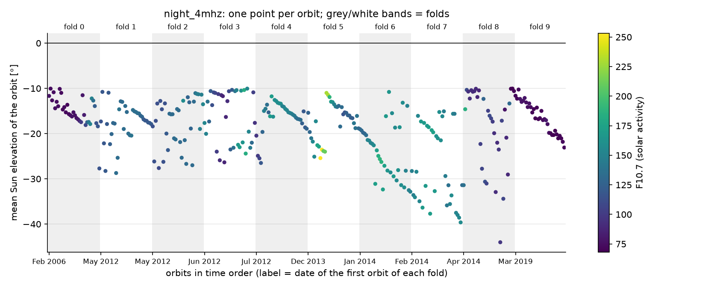
*Figure 2 – The 10 chronological folds of the night subset at 4 MHz (grey and white bands). The label
under each band is the date of its first orbit: folds 1–7 cover a few months each, fold 8 covers five years.*

---

## 5. Results

The results follow the path of the project: each step explains why the next one was needed.

### 5.1 One formula for everything?

PySR was first run on the **whole dataset** (all frequencies, day and night, all orbits; test on fold 9,
2019–2021). With 200 iterations the formulas stall at a test MAE of about 4.4–4.8 dB (linear 4.52,
GBM 4.20). With 2,000 iterations and 3 seeds the training error drops to about 4.1–4.3 dB and some
formulas reach the GBM on the test (~4.15–4.23 dB), but they are unreadable and **different for every
seed** at equal error: there is no stable global law.

The simplest recurring formula (complexity 7, identical in two seeds) is

$$
P = 39.5 - 10.0\,\left(\cos\chi + \log_{10} h\right),
$$

and its out-of-fold residuals (Figure 3, MAE 4.99 dB) show what is missing:

1. **Frequency:** 4 MHz is always above the formula and 5 MHz below → a gain depending on frequency is missing;
2. **Sun:** the residual is not a straight line in $\cos\chi$; by period the bias is −1.9 dB at night,
   +2.7 dB at twilight (Sun between −10° and 0°) and +0.2 dB by day → night and day behave differently;
3. **Orbits:** the residual distribution has a second bump below −8 dB (63 orbits, mostly at night in
   2012–2014 with high F10.7); the variance between orbits (23.1) is larger than the variance within
   orbits (17.2) → some orbits are anomalous as a whole;
4. **Solar activity:** the strongest correlation of the residual is with F10.7 at Mars (Spearman −0.30).

Each of these points corresponds to one split of the data, and they define the rest of the project:
**night first** (no ionospheric absorption), then the **anomalous orbits**, then the **frequency**,
then the **day**.

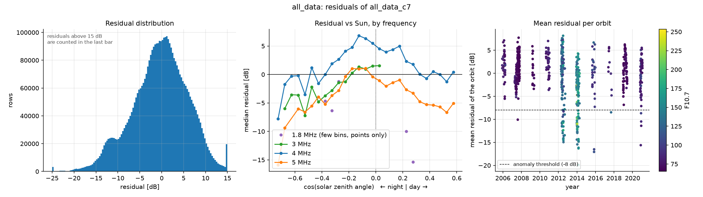
*Figure 3 – Residuals of the global formula: distribution, median residual against $\cos\chi$ by frequency,
mean residual per orbit.*

### 5.2 The night law at 4 MHz

At night (Sun elevation < −10°) the ionosphere absorbs very little, so the echo should depend only on
geometry, surface and antenna. The search uses the 4 MHz night data (866,829 rows, 339 orbits), the same
frequency studied by the paper.

**Search.** The three seeds find the same formulas up to complexity 7 (Figure 4):

$$
P = \frac{53.3}{\log_{10} h + \sigma/\lambda}\quad(\text{c}5),\qquad
P = 296.6\, e^{-\log_{10} h - \sigma/\lambda}\quad(\text{c}6),\qquad
P = \frac{160.7}{\left(\log_{10} h + \sqrt{\sigma/\lambda}\right)^2}\quad(\text{c}7).
$$

Altitude and roughness enter first in every run; the dipole tilt and the solar flux appear at higher
complexity (8–13), and at complexity 13 seed 1 uses $\log_{10}(\sigma/\lambda)$ and a linear dipole term
(−0.19 dB/degree). An earlier exploratory run found at complexity 14 the full log-linear form, which is the
classical **radar law**, with the solar flux added as in the paper:

$$
P = a_0 + k_h \log_{10} h + k_r \log_{10}(\sigma/\lambda) + k_{dip}\,\lvert\text{dip} - 90°\rvert + k_F\,F .
$$

In that run the altitude coefficient was −20.8, close to −20, the theoretical value of specular
reflection, found from the data without being imposed.

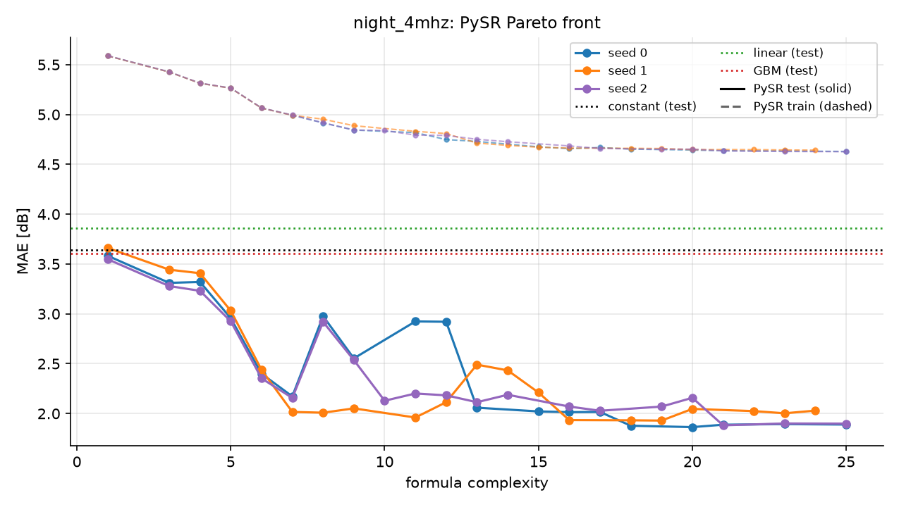
*Figure 4 – Pareto front, night at 4 MHz: one colour per seed; test error solid, training error dashed;
baselines dotted.*

**Validation** on the 10 folds (Figure 5):

| Model | Parameters | Mean MAE [dB] |
|---|---|---|
| GBM | – | 5.67 |
| Constant | 1 | 5.49 |
| Linear | 9 | 5.16 |
| c5 | 1 | 5.13 |
| c7 | 1 | 4.78 |
| c10 (c5 + dipole + F10.7) | 1 | 4.61 |
| **Radar law + F10.7** | 5 | **4.49** |

The formulas are the best models, and a one-parameter formula (c7) beats the linear model with nine.
The GBM is **worse than a constant**: trees cannot extrapolate outside the values seen in training, and
every chronological fold is a different regime. This is the main argument in favour of symbolic
regression on this dataset. For comparison, the paper reports MAE 4.50 dB for the EBM and 3.37 dB for
the neural network at 4 MHz; the numbers are not directly comparable (the paper uses day and night and
removes 8.5% of the samples), but the ranking "trees do not extrapolate" is consistent.

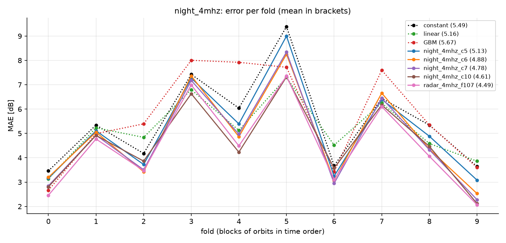
*Figure 5 – MAE per fold, night at 4 MHz (mean in brackets).*

Some folds stay at 6–7 dB for every model. The residuals explain why (Figure 6): the distribution is
**bimodal**, with a second peak around −15 dB, and the variance of the residuals is 30.2 between orbits
against 8.4 within orbits. The error is in whole orbits.

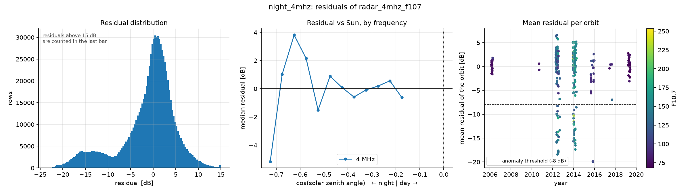
*Figure 6 – Residuals of the radar law at night, 4 MHz.*

### 5.3 Anomalous orbits

**Criterion.** An orbit is anomalous if its mean residual is below −8 dB (in the valley between the two
peaks). The reference law is refitted **iteratively** on the normal orbits only, until the list stops
changing (3 iterations).

**Result.** 47 orbits out of 339, 13.7% of the night rows, grouped in **10 episodes** between 2012 and
2015 (from 1 to 12 consecutive orbits, mean residual from −9.7 to −20.6 dB). The result depends little on
the threshold:

| Threshold | −6 dB | −8 dB | −10 dB | −12 dB |
|---|---|---|---|---|
| Anomalous orbits | 51 | 47 | 42 | 35 |
| % of night rows | 15.0 | 13.7 | 12.2 | 10.3 |

**Check independent of the formula: the noise floor.** The background noise (`median_corrected_echo_power`,
not used by any model) is mostly of galactic origin and crosses the ionosphere once; the echo crosses it
twice. If the cause is ionospheric absorption, both must drop (the echo more); if it were an instrumental
fault, the noise would not change. In the anomalous orbits the echo is 13.2 dB lower and the noise floor
1.8 dB lower, and per orbit the residual and the noise are correlated (Spearman 0.44, Figure 7).

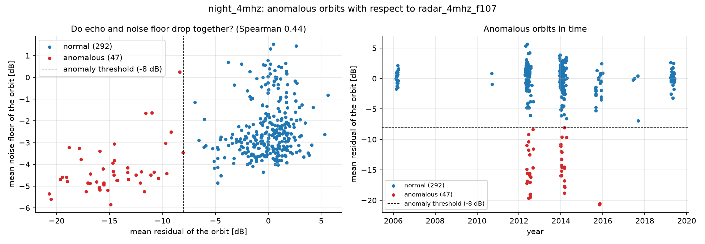
*Figure 7 – Left: mean residual against mean noise floor per orbit. Right: anomalous orbits in time.*

**Interpretation.** Episodes of **night-time ionospheric absorption** during intense solar events, not
described by F10.7 (a daily index). They probably correspond to the samples that the paper removes for
"intense solar activity" (8.5%); here they are found from the data and checked with an independent
variable.

**Effect on the law.** Without the anomalous orbits the solar coefficient $k_F$ halves (−0.087 → −0.042)
and the altitude coefficient moves from −22.5 to −25.1: part of the "F10.7 effect at night" was due to the
anomalous orbits, which fall in the years with high F10.7. On the clean data (10 folds):

| Model | MAE [dB] |
|---|---|
| Constant | 4.19 |
| c5 / c7 | 3.65 / 3.21 |
| GBM | 3.25 |
| Linear | 3.08 |
| **Radar law + F10.7** | **2.84** |

This is the **first logical split**: normal orbits, described by a physical law, and anomalous orbits,
which no available variable can predict.

### 5.4 All frequencies at night: the antenna resonance

The night data of all frequencies, without anomalous orbits (1.65 M rows, 297 orbits), are searched with
the frequency as an additional input.

**Search.** In **all three seeds** PySR adds to the altitude–roughness law a term that diverges near a
frequency between 3.57 and 4.10 MHz (Figure 8), for example (seed 1, complexity 14)

$$
P = \exp\!\left(\frac{7.49}{\log_{10} h} - \sqrt{\sigma/\lambda}\right) + \frac{1.15}{(f - 3.58)^2},
$$

with a test MAE of 1.9–2.0 dB against 2.31 for the GBM. A frequency with only four values could be fitted
by any function with enough parameters, so the term was tested in the validation rather than accepted at
face value.

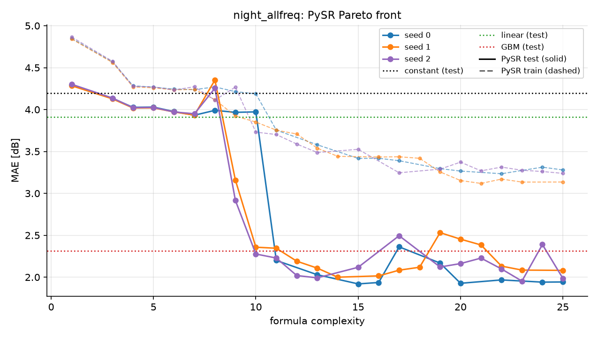
*Figure 8 – Pareto front, night at all frequencies: the drop around complexity 10–11 is the entry of the
frequency term.*

**Validation.** The radar law is extended with a gain $G(f)$, either free (one constant per frequency,
4 parameters) or with the form found by PySR (3 parameters):

$$
G(f) = g_0 + \frac{A}{(f - f_0)^2}.
$$

| Model | MAE | 1.8 MHz | 3 MHz | 4 MHz | 5 MHz |
|---|---|---|---|---|---|
| Constant | 4.58 | 4.15 | 4.70 | 4.62 | 4.03 |
| Linear | 3.81 | 5.34 | 3.76 | 3.82 | 3.58 |
| GBM | 3.64 | 4.72 | 4.28 | 3.42 | 2.83 |
| PySR c14 | 3.33 | 2.22 | 3.89 | 3.21 | 2.47 |
| PySR form + constant per $f$ | 3.27 | 3.67 | 3.82 | 3.14 | 2.41 |
| Radar law, free $G(f)$ | 2.98 | 4.06 | 3.44 | 2.84 | 2.13 |
| **Radar law, resonance $G(f)$** | **2.96** | **2.66** | **3.44** | **2.84** | **2.13** |

The resonance has **one parameter less** than the free gains and is as good at 3, 4 and 5 MHz, but it is
much better at 1.8 MHz (2.66 against 4.06 dB). 1.8 MHz appears in only two folds, so its free constant is
poorly estimated; the resonance instead **predicts** it from the other frequencies. $f_0 = 3.558 \pm 0.002$ MHz
in every fold.

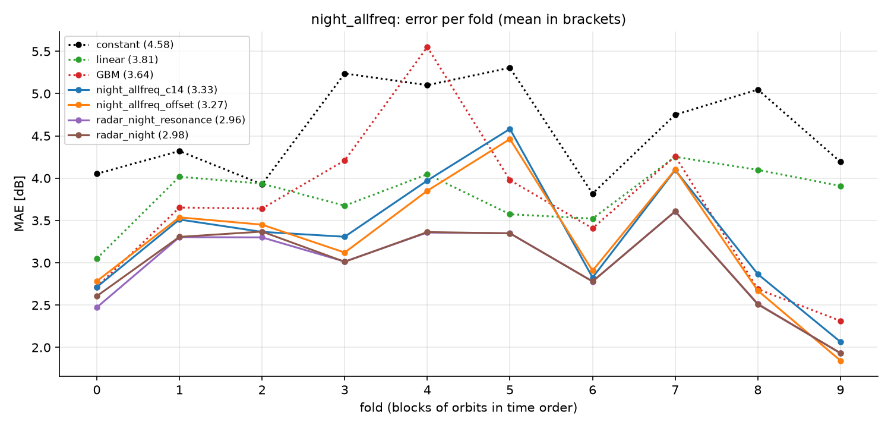
*Figure 9 – MAE per fold, night at all frequencies.*

**Night law**, estimated on all clean nights:

$$
P\,[\mathrm{dB}] = 75.9 + \frac{1.42}{(f - 3.558)^2} - 24.4\,\log_{10} h - 2.92\,\log_{10}\frac{\sigma}{\lambda} - 0.179\,\lvert\text{dip} - 90°\rvert - 0.041\,F .
$$

| Term | Value | Meaning |
|---|---|---|
| altitude | −24.4 dB/decade | geometry; theory −20 for specular reflection |
| roughness/λ | −2.9 dB/decade | scattering by a rough surface |
| dipole | −0.18 dB/degree | gain lost by a tilted antenna |
| F10.7 at Mars | −0.041 dB/unit | residual solar effect at night |
| $G(f)$ relative to 5 MHz | 1.8: −0.2, 3: +3.9, 4: +6.6 dB | antenna gain |

**Physical reading.** The MARSIS dipole is 40 m long. A half-wave dipole resonates at
$c/2L = 3.75$ MHz; real dipoles resonate slightly lower, at about $0.95\,c/2L \approx 3.56$ MHz, which
matches $f_0$. The paper, limited to 4 MHz, could not observe this effect.

### 5.5 Daytime ionospheric attenuation

**Definition.** The night law predicts the echo **without** a sunlit ionosphere. For every measurement

$$
\text{attenuation}\,[\mathrm{dB}] = P_{\text{night law}} - P_{\text{measured}} .
$$

As a check, at night the mean attenuation is close to 0 at every frequency (−0.8 dB at 1.8 MHz,
+0.07 to +0.29 dB at 3–5 MHz).

**What the data show** (Figure 10):
- the attenuation grows with the Sun, up to about 10 dB at 4 MHz with $\cos\chi \approx 0.5$;
- it starts **before sunrise at the ground** ($\cos\chi \approx -0.16$): the absorbing layer is high up and
  is lit before the surface;
- it is larger at lower frequency, but the ratio between 4 and 5 MHz is about 1.26 (1.17–1.34 by bin),
  while the classical $1/f^2$ law predicts $(5/4)^2 = 1.56$.

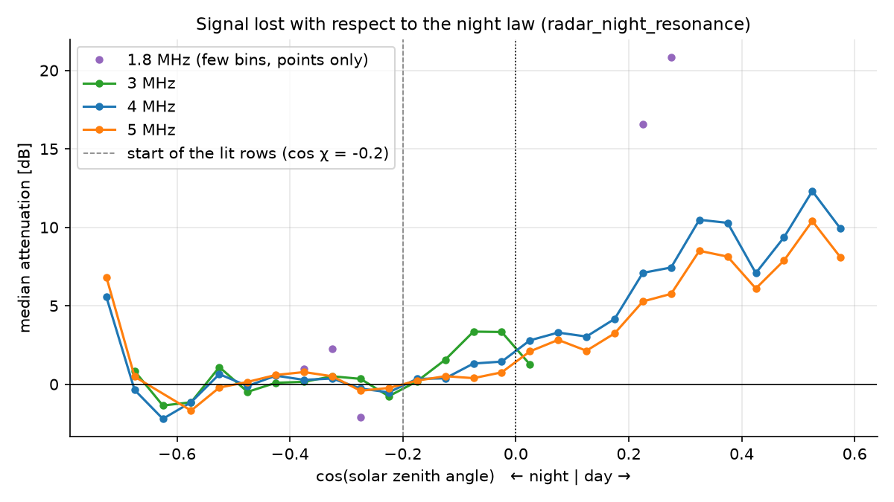
*Figure 10 – Median attenuation against $\cos\chi$ by frequency; dashed grey line = start of the rows used
($\cos\chi > -0.2$).*

**Search** on the lit rows ($\cos\chi > -0.2$, no anomalous orbits), inputs $\cos\chi$, $F$, $f$, with the
power operator. The elbow is at complexity 5–7 in every seed: first the Sun, then the frequency as $1/f$:

$$
A = \frac{61.8\,\cos\chi + 11.0}{f}\quad(\text{c}7),\qquad
A = k\,\frac{F}{40}\,\frac{\cos\chi + s}{f/4}\quad(\text{c}11,\ \text{with solar flux}).
$$

**Validation** (10 folds):

| Model | MAE | 3 MHz | 4 MHz | 5 MHz |
|---|---|---|---|---|
| Constant | 4.44 | 4.42 | 4.60 | 4.04 |
| GBM | 4.12 | 4.20 | 4.15 | 3.96 |
| Linear | 3.76 | 3.84 | 3.77 | 3.55 |
| Free exponents | 3.77 | 3.68 | 3.81 | 3.56 |
| Chapman ($m = p = \tfrac12,\ n = 2$) | 3.75 | 3.92 | 3.75 | 3.48 |
| PySR c7 (no solar flux) | 3.72 | 3.74 | 3.75 | 3.49 |
| **PySR ($m = p = n = 1$)** | **3.72** | **3.69** | **3.76** | **3.50** |

The differences between the formulas are small, because a single daytime measurement has ±3–4 dB of noise:
the forms are told apart by the confidence intervals of the exponents, not by the MAE.
(1.8 MHz is left out of the table: by day it is a single orbit, and every model has an error of about 19 dB.)

**Exponents.** The form with free exponents

$$
A = k \left(\frac{F}{40}\right)^{m} \left(\cos\chi + s\right)^{p} \Big/ \left(\frac{f}{4}\right)^{n}
$$

is fitted on all lit rows; the 95% intervals come from a **bootstrap over orbits** (40 resamplings of whole
orbits, because rows of the same orbit are not independent).

| Parameter | Meaning | Estimate | 95% CI | Range over the 10 folds | Chapman theory | Theory excluded |
|---|---|---|---|---|---|---|
| $n$ | frequency | **1.12** | 0.99 – 1.24 | 1.09 – 1.32 | 2 | **yes** |
| $p$ | Sun | **1.01** | 0.85 – 1.40 | 0.93 – 1.52 | 0.5 | **yes** |
| $m$ | solar flux | 0.65 | 0.17 – 1.18 | 0.42 – 0.78 | 0.5 | no |
| $s$ | onset shift | 0.16 | 0.11 – 0.24 | 0.15 – 0.21 | – | – |
| $k$ | attenuation in typical conditions [dB] | 17.4 | 15.2 – 20.5 | 16.3 – 24.6 | – | – |

- **$n \approx 1$:** the attenuation depends on frequency as $1/f$, not $1/f^2$. The estimate is stable in
  every fold and practically identical without 1.8 MHz (1.14).
- **$p \approx 1$:** the attenuation grows linearly with $\cos\chi$, not with $\sqrt{\cos\chi}$.
- **$s = 0.16$:** the attenuation vanishes with the Sun 9.2° below the horizon.
- **$m$:** not determined; the interval contains both 0.5 and 1 (few daytime data with a very active Sun).

### 5.6 A single model for the whole dataset

The two laws are combined into one model for every normal measurement (day, night, twilight, all
frequencies). At night $\cos\chi + s < 0$ and the attenuation term switches off by itself:

$$
P = \underbrace{g_0 + \frac{A}{(f-f_0)^2} + k_h\log_{10} h + k_r\log_{10}\frac{\sigma}{\lambda} + k_{dip}\lvert\text{dip}-90°\rvert + k_F F}_{\text{night law}}
\;-\; \underbrace{k\,\frac{F}{40}\,\frac{\max(\cos\chi + s,\,0)}{f/4}}_{\text{attenuation}} .
$$

With the constants averaged over the 10 training folds:

$$
P\,[\mathrm{dB}] = 66.9 + \frac{1.306}{(f - 3.573)^2} - 20.4\,\log_{10} h - 2.03\,\log_{10}\frac{\sigma}{\lambda} - 0.138\,\lvert\text{dip} - 90°\rvert - 0.041\,F \;-\; 19.6\,\frac{F}{40}\,\frac{\max(\cos\chi + 0.151,\,0)}{f/4} .
$$

| Term | Value (mean ± std over folds) | Meaning |
|---|---|---|
| $g_0$ | 66.9 ± 3.3 dB | reference level |
| $A$, $f_0$ | 1.306 ± 0.031, 3.573 ± 0.004 MHz | antenna resonance |
| $k_h$ | −20.4 ± 1.2 dB/decade | geometry; theory −20 for specular reflection |
| $k_r$ | −2.03 ± 0.10 dB/decade | scattering by a rough surface |
| $k_{dip}$ | −0.138 ± 0.007 dB/degree | gain lost by a tilted antenna |
| $k_F$ | −0.041 ± 0.006 dB/unit | residual solar effect at night |
| $k$, $s$ | 19.6 ± 1.7 dB, 0.151 ± 0.015 | daytime attenuation; it vanishes with the Sun 8.7° below the horizon |

Fitted together with the daytime data, the altitude coefficient moves from −24.4 (night law alone) to
−20.4, the value expected for specular reflection: the lit rows help to separate the geometry from the
attenuation.

All 9 parameters are estimated together on each training fold. Whole dataset without anomalous orbits
(3.96 M rows, 10 folds, Figure 11):

| Model | Parameters | MAE | 1.8 MHz | 3 MHz | 4 MHz | 5 MHz |
|---|---|---|---|---|---|---|
| Constant | 1 | 5.75 | 6.53 | 4.54 | 5.76 | 6.13 |
| Global formula (5.1) | 2 | 4.41 | 8.31 | 4.39 | 4.32 | 4.47 |
| Night law only | 7 | 4.31 | 7.41 | 3.65 | 4.56 | 3.90 |
| Linear | 9 | 4.03 | 11.48 | 4.14 | 4.10 | 3.47 |
| GBM | – | 3.52 | 6.50 | 4.06 | 3.40 | 3.00 |
| Single model, free exponents | 12 | 3.49 | 6.55 | 3.52 | 3.52 | 3.11 |
| **Single model** | **9** | **3.43** | 6.52 | **3.52** | 3.45 | 3.04 |

With the anomalous orbits included the ranking does not change: single model 4.05, GBM 4.46, linear 4.56.

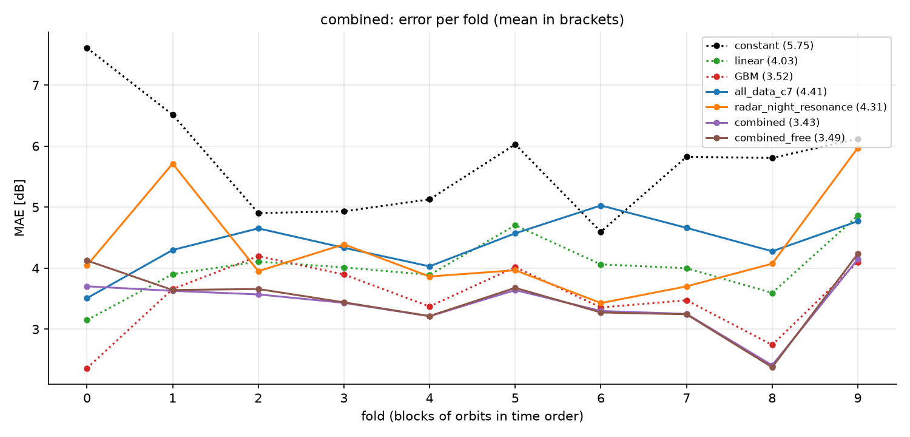
*Figure 11 – MAE per fold of the single model on the whole dataset.*

A 9-parameter formula that can be read term by term is **better than the black box** on the whole dataset.
Its residuals (Figure 12) have no bias by period (−0.21 dB at night, +0.03 at twilight, +0.04 by day), and
the variance between orbits drops from 23.1 (global formula) to 8.4.

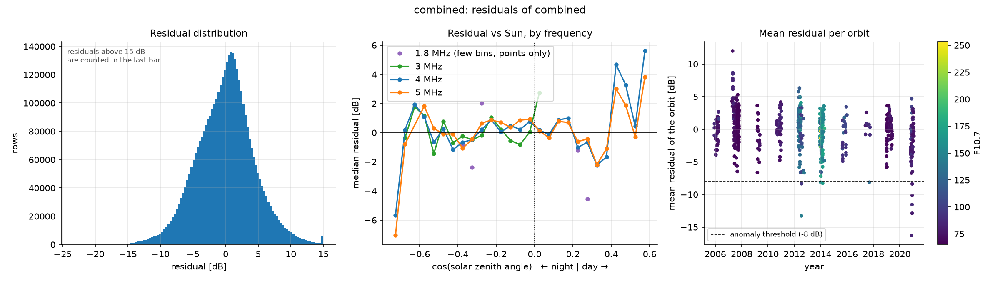
*Figure 12 – Residuals of the single model.*

**Logical partition of the dataset** that results from the project:

| Part | Description | Function |
|---|---|---|
| Normal orbits, dark ionosphere | night | radar law with antenna resonance |
| Normal orbits, lit ionosphere | day and twilight | radar law − ionospheric attenuation |
| Anomalous orbits (13.7% of the nights) | episodes of night-time absorption | not explained by the available variables |

---

## 6. Conclusions

One formula is not enough for the MARSIS dataset, and the residuals of a global formula show how to split
it: night and day, normal and anomalous orbits, frequency. Each part is described by a short physical law:

- **night:** the radar law, with an altitude coefficient close to the specular −20 dB/decade and an
  **antenna resonance** at 3.56 MHz found by PySR in every run;
- **day:** an ionospheric attenuation that starts with the Sun 9° below the horizon and scales as
  $1/f$ and $\cos\chi$, **not** as the classical $1/f^2$ and $\sqrt{\cos\chi}$;
- **anomalous orbits:** 13.7% of the nights, in 10 episodes, with the echo and the noise floor dropping
  together, a sign of absorption not captured by F10.7.

Joined in one 9-parameter model, the two laws reach MAE 3.43 dB on the whole dataset against 3.52 dB of the
gradient boosting, while remaining readable term by term.

---

## References

- M. Cranmer, *Interpretable Machine Learning for Science with PySR and SymbolicRegression.jl*, arXiv:2305.01582, 2023.
- Ferrari et al., *Explainable Artificial Intelligence for Quality Estimation of MARSIS Observations*, ECAI 2025.
